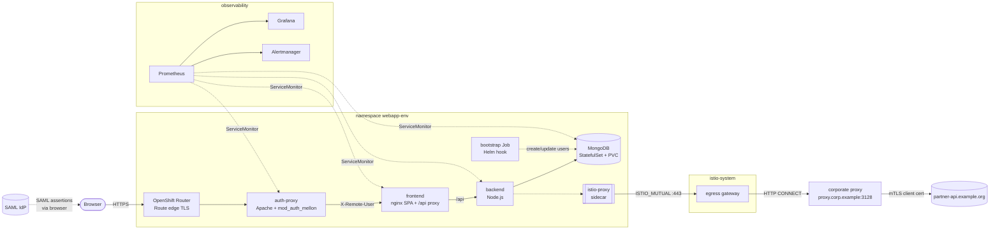
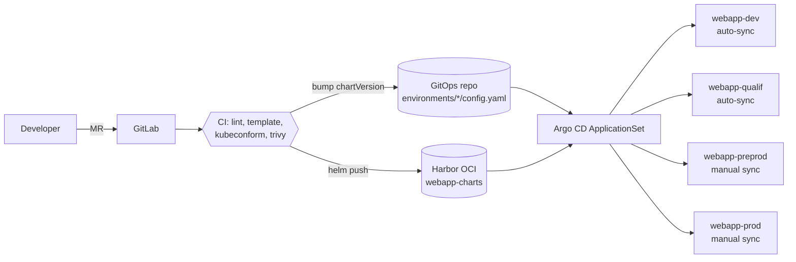

# Architecture

## Context

A 3-tier web application runs on a shared, hardened OpenShift platform operated
by a central platform team. Application teams get namespaces, a GitLab instance,
a Harbor registry, a Vault, an Argo CD instance and a Prometheus/Grafana/Loki
stack. Each application team owns only its namespaces and its GitOps repository.

Constraints that shaped the design:

| Constraint | Consequence in the chart |
|---|---|
| `restricted-v2` SCC: arbitrary UID, no root, no privilege escalation | No `runAsUser`/`fsGroup`, `runAsNonRoot`, `drop: [ALL]`, read-only root FS + `emptyDir` for writable paths |
| No direct Internet egress; everything goes through a corporate HTTP proxy | Istio egress gateway with CONNECT tunnelling (see [case study](case-study-istio-egress.md)) |
| Registry pulls from Docker Hub are rate-limited and discouraged | Every image comes from `harbor.example.org` (project images + `mirror/` proxy-cache) |
| Secrets must live in Vault, never in Git | `existingSecret` / `ExternalSecret` / `VaultStaticSecret`, no default credentials |
| Deployments only through GitOps | Chart published to an OCI registry, environments described in a GitOps repo, Argo CD ApplicationSet |

## Runtime view

### Components

| Component | Kind | Port(s) | Notes |
|---|---|---|---|
| auth-proxy | Deployment | 8080 http, 8081 health (internal), 9117 metrics | SAML 2.0 SP. Only component reachable from the router. SP key/cert and IdP metadata mounted from a Secret. |
| frontend | Deployment | 8080 http, 9113 metrics | nginx serving the SPA, reverse-proxying `/api` to the backend, CORS allow-list from values, `stub_status` on 127.0.0.1 for the exporter sidecar. |
| backend | Deployment | 3000 http (+ `/metrics`) | Node.js API. The only workload injected with an Istio sidecar. |
| mongodb | StatefulSet (1 member) | 27017, 9216 metrics | PVC via `volumeClaimTemplates`, retained on delete. Users created by an idempotent hook Job. |

## Delivery view

- The chart is the artefact: it is versioned, scanned and pushed once, then
  promoted by changing a version string in Git.
- `dev`/`qualif` sync automatically with self-heal; `preprod`/`prod` require a
  reviewed merge request **and** a manual sync.
- When autoscaling is enabled, Deployments do not set `spec.replicas` and Argo CD
  ignores that field, so GitOps and the HPA never fight.

## Environment matrix

| | DEV | QUALIF | PREPROD | PROD |
|---|---|---|---|---|
| Host | app-dev.example.org | app-qualif.example.org | app-preprod.example.org | app.example.org |
| Replicas (front / proxy / back) | 1 / 1 / 1 | 1 / 1 / 2 | HPA 2-5 / 2-4 / 2-5 | HPA 2-5 / 2-4 / 2-5 |
| VPA (recommendation) | - | - | yes | yes |
| Istio egress | no (app uses `HTTPS_PROXY`) | yes | yes | yes |
| Secrets | existingSecret | ExternalSecret | VaultStaticSecret | VaultStaticSecret |
| Alerts / dashboard | ServiceMonitor only | yes | yes | yes |
| MongoDB volume | 2Gi | 5Gi | 20Gi | 50Gi |
| Argo CD sync | auto | auto | manual | manual |

## Security posture (summary)

- Pods: non-root, no privilege escalation, all capabilities dropped,
  `RuntimeDefault` seccomp, read-only root filesystem, no service-account token.
- Network: default-deny ingress, explicit allows (router, intra-app, monitoring),
  restricted egress (DNS, intra-app, mesh). With Istio, the backend can only
  reach hosts declared in the mesh registry (`REGISTRY_ONLY`).
- Secrets: never rendered by the chart; synchronised from Vault; the partner
  client key lives only in the egress gateway namespace.
- Supply chain: images only from Harbor (scanned by Trivy in Harbor), chart
  scanned by `trivy config` in CI, `gitleaks` on every push.
- Guard rails at render time: invalid exposure/secret provider values and
  `NODE_TLS_REJECT_UNAUTHORIZED=0` make `helm template` fail.
