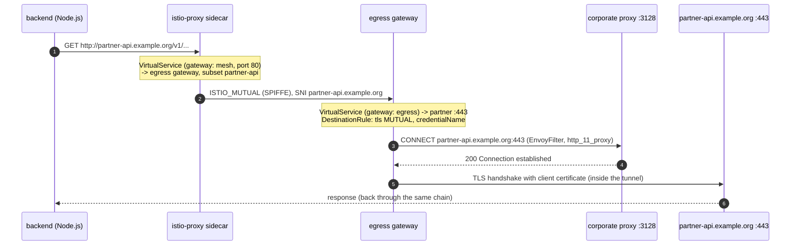

# Case study: mutual TLS to a partner API through a corporate proxy, moved into the mesh

## Problem

The backend had to call an external partner API. Three requirements stacked up:

1. **Mutual TLS**: the partner authenticates callers with a client certificate
   issued for this application.
2. **Mandatory proxy**: the cluster has no direct route to the Internet. All
   outbound traffic must go through a corporate HTTP proxy
   (`proxy.corp.example:3128`), which only accepts `CONNECT host:443`.
3. **Locked-down egress**: the security team wanted an explicit, auditable list
   of external destinations per application, not "whatever the code calls".

On paper it is "just" an HTTPS call with a client certificate and a proxy. In
practice the Node.js service could not do both cleanly:

- The proxy agents commonly used with Node's HTTP clients handle `CONNECT`, but
  passing a client certificate *through* the tunnel depended on the agent
  version and on how options were merged. In some combinations the certificate
  was silently dropped and the partner answered with a TLS handshake failure.
- Debugging happened in application logs, in a language-specific stack, with
  the private key mounted into the application container.
- A previous workaround in a non-production environment had been to set
  `NODE_TLS_REJECT_UNAUTHORIZED=0` to get past certificate errors behind the
  proxy - which disables server verification for **every** TLS call of the
  process.
- Every other service needing the same partner would have to re-solve the same
  problem in its own language.

## Decision

Treat "how to reach the partner" as a **platform concern**, not application code:

- The application calls **plain HTTP**: `http://partner-api.example.org`.
  No certificate, no proxy settings, no TLS options in the code.
- The **sidecar** captures the call and sends it to the **egress gateway** over
  Istio mutual TLS (so the plain HTTP never leaves the pod unencrypted).
- The **egress gateway** originates mutual TLS to the partner with the client
  certificate referenced by `credentialName` (a Secret in the gateway
  namespace), and **tunnels** the connection through the corporate proxy with
  HTTP `CONNECT`.
- The backend's sidecar uses `outboundTrafficPolicy: REGISTRY_ONLY`: any host
  not declared as a `ServiceEntry` is unreachable.



## Implementation (in this chart)

All objects are rendered only when `istio.enabled=true`:

| File | Object | Role |
|---|---|---|
| `templates/istio/sidecar.yaml` | `Sidecar` | Backend only; `REGISTRY_ONLY`; egress limited to own namespace + mesh namespaces. |
| `templates/istio/serviceentries.yaml` | `ServiceEntry` x2 | Partner host (ports 80/http and 443/https, `MESH_EXTERNAL`) and corporate proxy (`tcp` 3128, `MESH_EXTERNAL`). |
| `templates/istio/egress-routing.yaml` | `Gateway` | Egress gateway listener for the partner host, `ISTIO_MUTUAL`. |
| | `DestinationRule` | Sidecar -> gateway leg: `ISTIO_MUTUAL` with SNI = partner host. |
| | `VirtualService` | `mesh:80` -> egress gateway; `gateway:443` -> partner `:443`, with timeout + retries. |
| | `DestinationRule` | Gateway -> partner: `tls.mode: MUTUAL`, `credentialName`, SNI. |
| `templates/istio/envoyfilter-proxy-connect.yaml` | `EnvoyFilter` | Wraps the partner cluster's TLS transport socket in Envoy's `http_11_proxy` transport socket so the gateway issues `CONNECT` to the proxy first. |

Application side, the only change is the URL, computed by the chart:

```yaml
- name: PARTNER_API_URL
  value: "http://partner-api.example.org"   # istio.enabled=true
```

### Why an EnvoyFilter

Istio's API covers TLS origination and egress gateways, but has no first-class
field for "originate TLS, then send it through an HTTP/1.1 `CONNECT` proxy".
Envoy supports it through the `envoy.transport_sockets.http_11_proxy` transport
socket, so the EnvoyFilter is scoped as tightly as possible:

- `workloadSelector` = the egress gateway pods only;
- `match.cluster.service` = the partner host and port only;
- created in the gateway's namespace (an EnvoyFilter only selects workloads in
  its own namespace unless placed in the root namespace).

Because Envoy's `default_proxy_address` must be an IP address, the proxy
address is a per-environment value (`istio.corporateProxy.address`). When the
partner name is not resolvable from inside the cluster, set
`istio.partner.resolution: STATIC`: the `ServiceEntry` endpoint then points at
the proxy and name resolution happens on the proxy side.

EnvoyFilters patch generated configuration, so they are coupled to the Istio /
Envoy version. Validate with `istioctl proxy-config cluster <egress-pod>`
after each mesh upgrade.

## Result

- **Zero TLS/proxy code in the application.** The backend issues an HTTP call;
  the certificate, the CA bundle, SNI and the proxy are infrastructure
  configuration.
- **The private key left the application pod**: it lives only in a Secret in
  the egress gateway namespace (synchronised from Vault), readable by the
  gateway, rotatable without redeploying the application.
- **`NODE_TLS_REJECT_UNAUTHORIZED=0` removed everywhere** and now blocked at
  render time by the chart.
- **Auditable egress**: the list of external destinations is the list of
  `ServiceEntry` objects in Git. Anything else returns 502 from the sidecar.
- **Observable**: partner calls appear in Istio metrics
  (`istio_requests_total` with `destination_service_name`), with a dedicated
  alert (`WebappPartnerApiErrors`) and egress gateway access logs.
- **Reusable**: any other workload in the mesh can call the partner the same
  way by adding its namespace to the `Sidecar` egress hosts.

## Troubleshooting checklist

```bash
# 1. Is the backend going to the gateway?
istioctl proxy-config routes deploy/webapp-webapp-platform-backend -n webapp-prod --name 80 -o json | grep partner

# 2. Does the gateway have the partner cluster with the patched transport socket?
istioctl proxy-config cluster deploy/istio-egressgateway -n istio-system \
  --fqdn partner-api.example.org -o json | grep -A3 http_11_proxy

# 3. Is the client certificate loaded?
istioctl proxy-config secret deploy/istio-egressgateway -n istio-system | grep partner-api

# 4. Gateway access logs: look for response flags (UF, URX, UH) and upstream failure reasons
kubectl -n istio-system logs deploy/istio-egressgateway | grep partner-api
```

| Symptom | Likely cause |
|---|---|
| 502 from the sidecar, `BlackHoleCluster` in stats | Host not in a `ServiceEntry` or not in the `Sidecar` egress hosts. |
| 503 `UF` at the gateway | Proxy unreachable (NetworkPolicy / proxy address) or `CONNECT` refused. |
| TLS handshake failure from partner | `credentialName` Secret missing/expired, wrong namespace, or SNI mismatch. |
| Works in one environment, not another | Different `istio.corporateProxy.address` / partner host per environment. |
